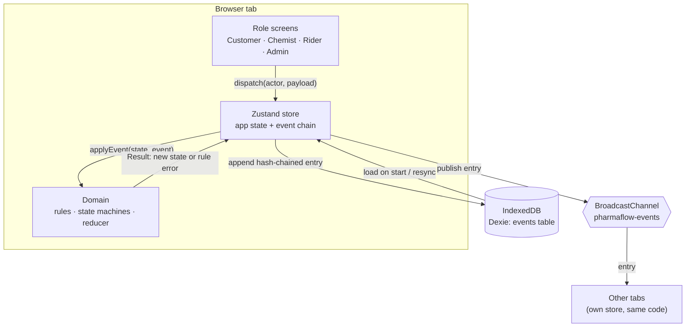
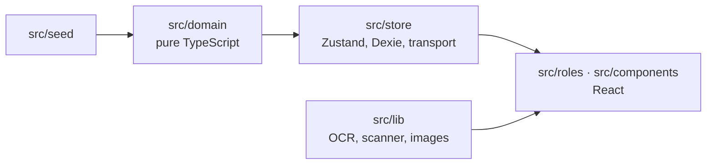
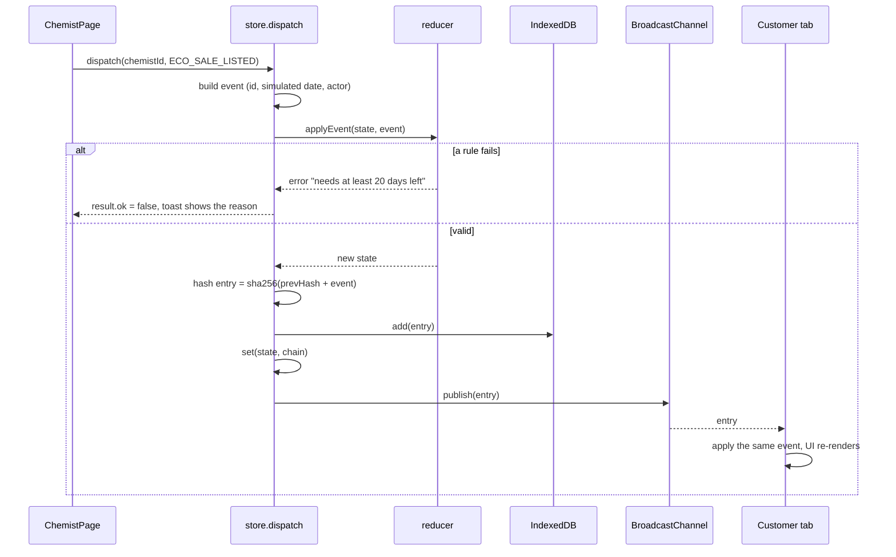
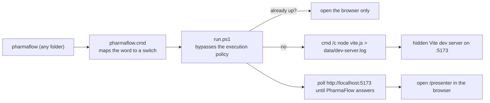

# PharmaFlow Architecture

This document explains how PharmaFlow is put together and why. For the business flows see [WORKFLOW.md](WORKFLOW.md); for the product overview see the [README](README.md).

## Contents

1. [Big picture](#big-picture)
2. [Layers and the one-way dependency rule](#layers-and-the-one-way-dependency-rule)
3. [Event sourcing](#event-sourcing)
4. [What happens when you click a button](#what-happens-when-you-click-a-button)
5. [Real-time sync across tabs](#real-time-sync-across-tabs)
6. [The audit ledger](#the-audit-ledger)
7. [Where each rule lives](#where-each-rule-lives)
8. [State shape](#state-shape)
9. [Simulated clock and time travel](#simulated-clock-and-time-travel)
10. [UI layer](#ui-layer)
11. [Launcher and the pharmaflow command](#launcher-and-the-pharmaflow-command)
12. [Libraries that load on demand](#libraries-that-load-on-demand)
13. [Sample database and server mode](#sample-database-and-server-mode)
14. [Testing](#testing)
15. [Design decisions and trade-offs](#design-decisions-and-trade-offs)
16. [Known limits](#known-limits)

---

## Big picture

PharmaFlow is a single-page React app. There is **no backend** in demo mode. Every user action becomes an immutable, typed **event**. The current state of the whole platform is `reduce(events)`. The events are stored in the browser (IndexedDB) and shared between open tabs with `BroadcastChannel`.



Because every tab runs the same pure reducer over the same log, all tabs converge on the same state without a server.

## Layers and the one-way dependency rule



| Layer | Folder | May import | Must not |
|---|---|---|---|
| Domain | `src/domain` | Itself, `zod` | Import React, the store, `localStorage`, `Date.now()` or `Math.random()` |
| Seed | `src/seed` | Domain types | Contain logic |
| Store | `src/store` | Domain, Zustand, Dexie | Contain business rules |
| UI | `src/roles`, `src/components` | Domain (selectors, rules for display), store | Decide whether an action is allowed |
| Lib | `src/lib` | Browser APIs, lazily loaded libraries | Touch application state |

The rule that matters most: **business rules never live in React components**. A component calls `dispatch(...)`. If the action breaks a rule, the reducer returns an error message and the component only shows it.

## Event sourcing

Every action is a member of the `DomainEvent` union in `src/domain/events.ts`. Each event carries `id`, `at` (the simulated date), `actorId` and a typed payload.

| Family | Events |
|---|---|
| Admin and KYC | `STORE_REGISTERED`, `KYC_DECIDED` |
| Inventory | `STOCK_INGESTED`, `ECO_SALE_LISTED`, `ECO_SALE_WITHDRAWN` |
| Orders | `ORDER_PLACED`, `RX_APPROVED`, `RX_REJECTED`, `RX_RESUBMITTED`, `ORDER_CANCELLED`, `ORDER_PACKED`, `ORDER_ACCEPTED`, `ORDER_ARRIVED`, `ORDER_OUT_FOR_DELIVERY`, `ORDER_DELIVERED` |
| Pickups | `PICKUP_SCHEDULED`, `PICKUP_ACCEPTED`, `PICKUP_ARRIVED`, `PICKUP_COLLECTED`, `PICKUP_QA_VERIFIED`, `PICKUP_QA_REJECTED`, `PICKUP_DELIVERED_TO_NGO`, `PICKUP_INCINERATED` |
| Rewards and civic | `SCRATCH_CARD_REVEALED`, `BLOOD_BOOKED`, `BLOOD_DONATION_CONFIRMED` |
| Riders and presenter | `RIDER_SHIFT_CHANGED`, `TIME_TRAVELLED` |

The reducer (`src/domain/reducer.ts`) exposes two functions:

- `applyEvent(state, event)` returns `{ ok: true, value: newState }` or `{ ok: false, error }`. It never throws.
- `reduce(initialState, events)` replays stored events. Stored events were validated when they were appended, so a failure here means the log was written by incompatible code.

The reducer is a thin `switch` that hands each event to a handler module in `src/domain/handlers/`:

| Module | Handles |
|---|---|
| `inventory.ts` | KYC, stock, Eco-Sale, rider shifts, time travel |
| `orders.ts` | Placing, prescription review, packing, delivery, cancellation |
| `pickups.ts` | Donation and bio-disposal pickups, QA |
| `civic.ts` | Scratch cards and blood donation |
| `payouts.ts` | Rider pay, scratch-card grants, certificates (used by the others) |
| `common.ts` | Role guards (`requireRole`, `requireChemistOf`, `requireApprovedStore`) and small helpers |

## What happens when you click a button

Example: the chemist presses **Put on Eco-Sale**.



Nothing is written unless every rule passes, so the log only ever contains valid history.

## Real-time sync across tabs

Each tab has its own store instance (`src/store/index.ts`). Three small interfaces keep the pieces swappable:

| Interface | Demo implementation | Test implementation | Server mode (planned) |
|---|---|---|---|
| `EventStorage` | `DexieStorage` (IndexedDB, table `events` keyed by `index`) | `MemoryStorage` | SQLite via an API |
| `Transport` | `BroadcastTransport` (channel `pharmaflow-events`) | `MemoryTransport` on a shared `MemoryBus` | WebSocket |
| Sessions | `sessionStorage`, per tab | none | JWT cookie |

How a tab behaves:

1. **Start:** load every entry from storage, replay it with `reduce`, subscribe to the transport.
2. **Local action:** the store runs `dispatch` through a **serial queue**, so two quick clicks in one tab never interleave.
3. **Incoming entry:** if `entry.index` is exactly the next one and its `prevHash` matches the local tail, apply it. If it is older, ignore it. Otherwise **resync** from storage.
4. **Conflict:** if two tabs write entry *N* at the same moment, `storage.append` rejects the second one (the primary key is `index`). That tab resyncs, **validates its event again against the newer state**, and retries up to three times. Example: two tabs both travel to the same date; the second is rejected with "Time can only move forward".
5. **Reset:** clears storage and publishes `{ kind: 'reset' }`. Every tab returns to the seed.

The `/presenter` page embeds each role as an `<iframe src="/role?embed=1">`. Each iframe is a separate document with its own store, so it syncs exactly like a separate browser tab.

## The audit ledger

`src/domain/ledger.ts` wraps events in entries:

```
entry[i] = { index: i, event, prevHash: entry[i-1].hash, hash: sha256(prevHash + canonicalJSON(event)) }
```

- Entry 0 starts from a fixed genesis hash of 64 zeros.
- `canonicalize` sorts object keys and drops `undefined`, so the same event always hashes the same.
- `verifyChain` recomputes every hash. It reports the first broken index and why: index out of sequence, previous hash mismatch, or altered content.
- Hashing uses Web Crypto (`crypto.subtle`), so no dependency is needed.

The Admin portal's **Verify ledger integrity** button calls `verifyChain` on the live chain. The Audit trail list is simply the last ten entries.

## Where each rule lives

All rules are pure functions in `src/domain/rules/`, each with its own unit tests.

| File | Rule |
|---|---|
| `expiry.ts` | SAFE > 180 d, LOCKOUT 30–180, CRITICAL 1–29, EXPIRED ≤ 0 |
| `ecoSale.ts` | 40–60% discount; eligible only if `days_left ≥ course_days + 15`; never expired; never Schedule X; deeper discount closer to expiry |
| `donation.ts` | Sealed, more than 30 days left, not cold-chain, not Schedule X, not an opened liquid; Rx-only drugs only to NGOs with a registered professional |
| `prescription.ts` | Schedule H/H1 need an Rx; required fields; validity 30 days (antibiotics) or 180 days; antibiotic Rx single-use; quantity cap; packing gate; H1 register with 3-year retention; Schedule X blocked |
| `rxText.ts` | Turns OCR text into **suggestions** for the Rx form. OCR never approves anything |
| `generic.ts` | Cheaper generic offer, always labelled "Same salt, same strength" |
| `rewards.ts` | Donation +200 karma and a scratch card; disposal +150; blood +500 with a certificate and badge only; closed-loop wallet; deterministic scratch rewards |
| `gst.ts` | Write-off certificate with the GST ITC reversal (CGST Sec 17(5)(h)); never called 80G |
| `gs1.ts` | Parses GS1 element strings (GTIN, batch, expiry), symbology prefixes and plain EAN barcodes. `parseScan` is used for both camera results and typed barcodes (spaces and hyphens ignored) |

State machines are in `src/domain/machines/`:

- `order.ts`: `PLACED → [RX_APPROVED] → PACKED → OUT_FOR_DELIVERY → DELIVERED`, plus `CANCELLED` before packing.
- `pickup.ts`: donation `SCHEDULED → COLLECTED → QA_VERIFIED | QA_REJECTED → DELIVERED_TO_NGO | INCINERATED`; disposal `SCHEDULED → COLLECTED → INCINERATED`. Invalid jumps are rejected.

Two modules sit on top of the rules:

- `checkout.ts` quotes a cart (first-expiry-first-out batch picking, Eco-Sale pricing, stock checks) and plans an order.
- `selectors.ts` derives everything the screens show: store inventory with buckets, Eco-Sale listings, impact KPIs, open rider missions and backhaul suggestions.
- `route.ts` turns a rider's active orders and pickups into an ordered list of stops (store or pickup point, customer, chemist QA, NGO, CBWTF), the rider's current position, and distance and ETA at 25 km/h. It is pure and tested; the map only draws what it returns.

The reducer **re-checks every rule** even when the UI already checked. For example, `ORDER_PLACED` recomputes prices from the batches, re-validates the prescription and re-checks stock, so a stale or tampered client cannot slip an invalid order into the log.

## State shape

`AppState` (`src/domain/state.ts`) is built from a `Seed` and then changed only by events.

| Group | Fields |
|---|---|
| Clock | `today` |
| Reference data (seed) | `medicines`, `stores`, `ngos`, `bloodBanks`, `users`, `cbwtf` (the incineration plant) |
| Transactions | `batches`, `orders`, `pickups`, `prescriptions`, `h1Register`, `scratchCards`, `bloodBookings` |
| Balances | `karma`, `wallet` (per user) |
| Outputs | `certificates`, `riders` (online flag, earnings, incentives, trips) |

Everything is stored as plain records keyed by id, so state is easy to diff, serialise and map to SQL tables.

## Simulated clock and time travel

Domain code never reads the real time. Every rule takes `today` as an ISO date (`YYYY-MM-DD`). `state.today` starts at the seed date (2026-11-08) and moves only through `TIME_TRAVELLED`, which can go **forward only**. That is what lets the presenter jump +5 months and watch batches change bucket live.

Some rules are deliberately re-checked after time passes:

- Eco-Sale listings disappear once `days_left` no longer fits the course.
- A prescription's validity is re-checked when the chemist approves it.
- A donation's shelf life is re-checked at the QA desk.

Going back means **Reset demo data**, which clears the log.

## UI layer

| Piece | Purpose |
|---|---|
| `PresenterBar` | Role switch, time-travel slider and jump buttons, reset |
| `RoleGate` | 1-tap demo login per role; sessions are per tab |
| `toast` | Shows rule errors and confirmations |
| `ui.tsx` | Button, Card, Badge, Stat primitives with the design tokens |
| `roles/customer` | Phone-style app with Shop, Deals, Cart and Orders tabs. Cart state is local to the tab (not part of the event log) |
| `roles/chemist` | Dashboard: expiry ledger, **Add inventory** (scan, type or choose medicine), packing desk, QA desk |
| `roles/rider` | Dark mission radar with large lifecycle buttons, plus the navigation panel and map |
| `roles/admin` | KYC queue, KPI cards, audit trail |

Styling is Tailwind CSS v4 with design tokens in `src/index.css` (medical blue, emerald, amber, crimson). Framer Motion is used for short, subtle transitions only.

## Launcher and the pharmaflow command

`pharmaflow` is a small Windows command that starts and stops the app without a terminal window left open.



Details that were learned the hard way and are worth keeping:

- **"Is it running?" is an HTTP check**, not a port check. On this setup Vite listens on IPv6 only (`[::1]`), and `netstat` and `Get-NetTCPConnection` report that listener unreliably. The launcher asks `http://localhost:5173/` and looks for "PharmaFlow" in the page.
- **`stop` finds the process by command line**, and only touches `node.exe` processes whose command line contains this project's folder and `vite --port 5173`. It never kills a program that merely uses the same port.
- **The server is started through `cmd /c ... > log 2>&1`** instead of `Start-Process -RedirectStandardOutput`. That way the hidden server inherits none of the launcher's handles, so the terminal (or any pipe reading it) is released immediately.
- `scripts/install-command.ps1` adds the project folder to the **user** Path only (no administrator rights), keeps existing entries untouched, and `-Remove` takes it out again.
- `Start PharmaFlow.cmd` is the double-click version and keeps its window open only if something fails.

## Libraries that load on demand

Three heavy libraries are imported dynamically, so they cost nothing until used:

| Library | File | Loaded when | Network |
|---|---|---|---|
| **ZXing** (`@zxing/browser`) | `src/lib/scanner.ts` | The chemist opens the camera scanner | None. Needs the camera and a secure context (`localhost` or HTTPS) |
| **Leaflet** (`leaflet`, `react-leaflet` v4) | `src/roles/rider/RouteMap.tsx` | A rider has a route to show (its own lazy chunk of about 150 kB) | Street tiles come from the free OpenStreetMap servers. Offline, or after repeated tile errors, `RouteMapSvg` takes over |
| **Tesseract.js** | `src/lib/ocr.ts` | The customer presses "Read with OCR" | Downloads about 10 MB of English language data on first use, then the browser caches it |

The map darkens OpenStreetMap tiles with a CSS filter (`.pf-dark-tiles`) because CARTO's dark basemap now answers with an "API KEY REQUIRED" watermark, and the project must work with no keys. The rider's moving dot is a local animation (`useRiderPosition`) and is never written to the event log.

All three fail gracefully: the scanner dialog explains camera problems and offers typing the barcode (or a preset), the map falls back to a route diagram, and the Rx form falls back to typing. Prescription photos are shrunk (`src/lib/image.ts`) before they enter the event log.

## Sample database and server mode

`npm run db:sample` (`scripts/sample-db.ts`) runs a scripted day through the real reducer and writes `data/pharmaflow-sample.db` using Node's built-in `node:sqlite`. `scripts/schema.sql` defines the tables.

| SQL table | Comes from |
|---|---|
| `medicines`, `stores`, `ngos`, `blood_banks`, `users` | Seed / reference data |
| `batches`, `orders` + `order_items`, `pickups` + `pickup_items`, `prescriptions` + `prescription_drugs`, `h1_register`, `scratch_cards`, `certificates`, `blood_bookings`, `rider_profiles` | `AppState` after replay |
| `events` | The hash-chained log (`idx`, `type`, `actor_id`, `sim_date`, `payload` JSON, `prev_hash`, `hash`) |

The `events` table is the source of truth; every other table is a projection of it. The views `v_expiry_ledger` and `v_order_summary` show how reporting queries become plain SQL.

**Server mode (planned, roadmap step 8)** keeps the same events and reducer. A Hono API would validate events with the same domain code, store them in SQLite, and push them to clients over WebSockets, replacing `DexieStorage` and `BroadcastTransport` behind the same two interfaces.

## Testing

Vitest runs 166 tests in 17 files, in about a second.

| Area | What is covered |
|---|---|
| Rules | Every boundary: 180/30/1-day buckets, 40–60% discounts, course buffer, donation exclusions, Rx validity and single-use, GS1 parsing, rewards, GST |
| State machines | Allowed and rejected transitions for orders and pickups |
| Reducer | KYC, stock, Eco-Sale, orders, prescription review, H1 register, donations, disposal, blood, time travel |
| Checkout | Cart quoting, batch splitting, order planning |
| Store | Cross-tab sync, simultaneous writes, reset, restore, ledger tamper detection (two stores on a shared in-memory log and bus) |
| Walkthrough | `tests/walkthrough.test.ts` runs the README demo, steps 1–9, headlessly |

The browser flows (camera scan, OCR, prescription checkout, cross-tab delivery) were also exercised in real Chrome, using a fake camera feed for the scanner.

## Design decisions and trade-offs

| Decision | Why | Cost |
|---|---|---|
| Event sourcing | Audit trail, KPIs, time travel and sync fall out of one log | State is rebuilt by replay; a rule change can invalidate old logs (the store then resets safely) |
| Pure domain, no `Date.now()` | Deterministic tests and demo time travel | Everything must pass `today` explicitly |
| Reducer re-validates everything | UI is never trusted | Some checks run twice |
| Two swappable interfaces (storage, transport) | Same code for demo and server mode | A little indirection |
| `Result` values instead of exceptions | Rule failures are normal and carry a user-facing message | Call sites must check `ok` |
| BroadcastChannel + IndexedDB | Zero setup, no accounts, no cloud | Works only on one browser profile |
| Dynamic imports for OCR and camera | Fast first load | A first-use delay for OCR |

## Known limits

- **Demo trust model.** Roles are chosen with demo logins, and the reducer checks the `actorId` it is given. In a real deployment the server must authenticate users and run the same reducer.
- **One browser profile.** Tabs sync only within the same browser profile and origin.
- **Drug schedules are demo data.** Check them against the latest CDSCO and Drugs & Cosmetics Rules before any real use.
- **GST and costs are assumptions.** The write-off certificate uses a 12% default rate and a cost of 70% of MRP, both configurable.
- **Map tiles use the public OpenStreetMap servers.** That is fine for a demo and light use. A production app should use its own tile provider or host tiles itself, following the OSM tile usage policy.
- **The rider position is simulated.** There is no GPS: the dot glides between stops for display only.
- **Camera needs a secure context.** Use `http://localhost`, not a LAN IP over plain HTTP.
- **Prescription OCR is a suggestion engine.** A pharmacist always makes the final decision.
