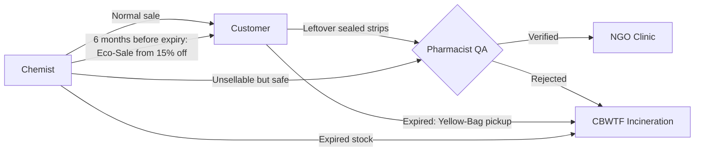

# 💊 PharmaFlow

**Medicine reverse logistics, near-expiry liquidation and civic health on one platform.**

PharmaFlow turns the one-way "buy → use → throw away" medicine chain into a **closed loop** connecting four roles: **Customers**, **Medical Stores (Chemists)**, **Delivery Riders** and **Admins / NGOs / Blood Banks**.

> 🎓 PBL project · Pilot region: **Mangaluru, Karnataka**
> ✅ All four role apps, server mode, installable PWA and English / ಕನ್ನಡ / हिन्दी are built and tested (284 unit tests, 14 browser tests).

📖 **More docs:** [WORKFLOW.md](WORKFLOW.md) (every flow + demo script) · [ARCHITECTURE.md](ARCHITECTURE.md) (how the code works) · [TODO.md](TODO.md) (what's left)

---

## 🔥 The problem

- **Chemists lose money.** Legacy ERPs cost ~₹35,000 in year one. Distributors refund only 50% on stock with 6+ months left, as a slow credit note, and **refuse anything under 6 months**, a 100% loss.
- **Households dump medicines illegally.** ~73% bin them and ~20% flush them, though the Bio-Medical Waste Rules 2016 require incineration at an authorised CBWTF. Antibiotics in soil and water breed **antimicrobial resistance**.
- **The paradox:** safe, unexpired medicines go to waste while **NGO clinics run short of medicines** and **blood banks run short of blood**.

## 💡 How PharmaFlow fixes it



| Role | What it does |
|---|---|
| 🛒 **Customer** | Shop 46 items with pictures in six aisles (medicines, skin care, women's hygiene, oral care, baby care, first aid & devices) and a cheaper-generic switch · **Eco-Sale** near-expiry deals · Rx upload with OCR · donate leftovers to NGOs · Yellow-Bag disposal of expired medicines · book blood donation · live order tracker · karma points, scratch cards, PDF certificates |
| 🏪 **Chemist** | Free ERP (₹0 licence/AMC) · camera barcode scan with GS1 batch + expiry · expiry ledger (Safe / Lockout / Critical / Expired) · **6-month expiry alerts** with the Eco-Sale price split · one-click **Eco-Sale / Donate / Dispose** · Rx review + packing desk · QA desk for returns · write-off receipts with GST ITC reversal |
| 🏍️ **Rider** | Mission radar (🔵 delivery · 🟢 NGO pickup · 🟠 bio-hazard) · map with route, ETA and call · Accept → Collected → Delivered (OTP) · **backhaul**: pick up returns on the same trip |
| 🛡️ **Admin** | Pharmacy KYC (drug licence + GSTIN) · impact KPIs and charts · **every store and order** at a glance · NGO fund · **SHA-256 hash-chained audit ledger** with one-click verification |
| 🏭 **Dealer** | Quotes on **pooled bulk orders** from several stores (e.g. 450 packs of syringes). A buyer's agent and each dealer's agent negotiate in up to 3 rounds; the admin awards the best effective price and the winner delivers to every store. **PharmaFlow pays the dealer**, then **each store pays PharmaFlow its share**. See [WORKFLOW.md](WORKFLOW.md#13-pooled-bulk-orders-and-dealer-negotiation) |

**Demo data:** 6 customers, 7 medical stores (one awaiting KYC), 3 riders and 3 dealers, all with 1-tap logins.

## 🎨 Look and feel

All four roles share one light theme with clear, coordinated colour. White cards sit on a cool blue-grey background under light-blue header cards. One deep blue marks the main action and the active tab. Stats and buttons are tinted by what they mean: green for safe stock and Eco-Sale, amber for expiry warnings, orange for hazards, and red for disposal and blood. The rider screen and its map are light too.

- **Design tokens** (colours, radius, shadows) live in `src/index.css`, and the shared Button, Badge, Card and Stat are in `src/components/ui.tsx`. The rules are in [ARCHITECTURE.md → Design system](ARCHITECTURE.md).
- **Figma:** [PharmaFlow UI - light theme refresh](https://www.figma.com/design/h7QSbAidVEjCAneN5kfPyd) holds the same tokens as variables, before-and-after screens of every role, and a component sheet.

### 💸 How an Eco-Sale is split

Six months before a batch expires, the chemist gets an **expiry alert** and can put it on Eco-Sale in one click. Fresh stock is never discounted.

| ₹200 strip, 6 months before expiry | |
|---|---|
| Customer pays (15% off) | **₹170** |
| PharmaFlow fee (10% of the MRP) | ₹20 |
| Medical store receives | **₹150** |

Closer to expiry the suggested discount deepens (50% under 90 days, 60% under 45). The demo store stocks 46 items (29 medicines plus sanitary pads, sunscreens, face serums, face washes, toothbrushes, syringes and more), each with a fresh batch, so the shop never runs dry. Details: [WORKFLOW.md → Eco-Sale](WORKFLOW.md#2-eco-sale-rescuing-near-expiry-stock).

---

## 📋 Prescription rules (Rx-only drugs)

Some medicines **can't be bought without a valid prescription**. This is enforced in the domain rules, not just the UI.

| Category | Examples | Prescription? | What the app does |
|---|---|---|---|
| **OTC** | Dolo 650, Shelcal, Electral, Volini | ❌ No | Straight to checkout |
| **Schedule H** | Augmentin 625, Azithral 500, Pan-D | ✅ Yes | Upload Rx → **chemist approves** before packing |
| **Schedule H1** | (rule engine supports it) | ✅ Yes + register | Every sale logged in the H1 register |
| **Schedule X / NDPS** | — | 🚫 Never | Blocked: can't be sold, donated or listed |

1. An order with an Rx-only item **can't be packed** until the chemist approves the prescription.
2. **OCR only reads the prescription; the pharmacist decides.**
3. The Rx must show doctor name, **registration number**, date, patient and drug. Antibiotic prescriptions are valid 30 days and single-use.
4. **Eco-Sale doesn't skip the rule**: discounted Augmentin still needs a prescription.
5. Every approval and rejection is written to the audit ledger.

> ⚠️ Drug schedules in the demo data are for demonstration. Verify against current CDSCO lists before real use.

---

## 📚 Research behind it

| Source | Finding | Feature in PharmaFlow |
|---|---|---|
| Jose & Surendran (2025) | Incentives and awareness drive medicine returns | Karma, scratch cards, certificates |
| Wickens et al. (2024) | Returned medicines can be reused if inspected | Pharmacist QA desk + audit trail |
| Kanyari (2024); IJCMPH | Households dump drugs because pharmacies won't take them back | Free doorstep pickup |
| Sorensen et al. (2024) | Barcode scanning cuts expiry checks by 59% | GS1 scan-to-ingest + expiry ledger |
| **Forkan, Rizvi & Chowdhury (2021)**: multi-objective reverse-logistics inventory | Returns have their own demand; when they arrive faster than demand, holding cost rises. Cost, CO₂ and energy must be balanced together | Pace NGO pickups to NGO capacity · show **₹ recovered, kg CO₂, km travelled** for every batch action |
| **Xue, Dong et al.**: reverse-logistics system for medical waste | Hub sites (K-means), full tracking and cost + risk routing cut working time **58.4%** and cost **20.8%** | **Green Hub** chemists for bulk Yellow-Bag collection · QR + weight check on every bag · routes scored on distance + hazard |

🎥 2-minute explainer of the two papers: [`media/PharmaFlow_Research_Takeaways.mp4`](media/PharmaFlow_Research_Takeaways.mp4)

---

## 🚀 Run it

Requires **Node.js 22+** and Chrome or Edge.

```bash
git clone https://github.com/chethan-9817/pharma_flow_1.git
cd pharma_flow_1
npm install
npm run dev
```

Open **`http://localhost:5173/presenter`** to see all four roles side by side, or `/customer`, `/chemist`, `/rider`, `/admin` in separate tabs. Use the **1-tap demo login** buttons.

On Windows you can also double-click **`Start PharmaFlow.cmd`**. For the `pharmaflow` command, server mode, tests and troubleshooting, see [WORKFLOW.md](WORKFLOW.md#developer-workflow).

## 🎬 Demo in 60 seconds

1. **Chemist** scans Dolo 650 → **Time-Travel** +5 months → batch turns amber → **Put on Eco-Sale**.
2. **Customer** sees it instantly at 50% off, adds Augmentin too → checkout locked → uploads Rx.
3. **Chemist** approves the Rx → **Pack & Summon Rider** → **Rider** delivers with OTP.
4. **Customer** scratches a reward card, then donates leftovers → rider pickup → chemist QA → NGO → PDF certificate.
5. **Admin** sees the KPIs move and clicks **Verify Ledger** → ✅ chain intact.

Full script with timings: [WORKFLOW.md → Demo script](WORKFLOW.md#demo-script).

---

## 🧰 Tech stack

**Frontend:** React 18 · TypeScript · Vite · Tailwind + shadcn/ui · Zustand · Dexie (IndexedDB) · Zod · React Router
**Features:** ZXing (barcode) · Tesseract.js (OCR) · Leaflet + OpenStreetMap · jsPDF + QR · Recharts · canvas scratch cards
**Design:** calm light theme · Inter (Noto for Kannada and Hindi) · tokens in `src/index.css`, mirrored in Figma
**Sync:** event-sourced core, BroadcastChannel across tabs (demo) or WebSocket (server)
**Server:** Hono · `node:sqlite` · bcrypt + JWT
**Other:** PWA (Workbox) · react-i18next (en / kn / hi) · Vitest · Playwright

Every action is an event in one hash-chained log. State, live sync, KPIs and the audit trail all come from that log. Details in [ARCHITECTURE.md](ARCHITECTURE.md).

---

> Academic prototype, not legal or medical advice. Blood donation earns no money-value rewards (India's voluntary donation policy), and MedWallet is closed-loop store credit.

**Author:** Chethan · [@chethan-9817](https://github.com/chethan-9817)
