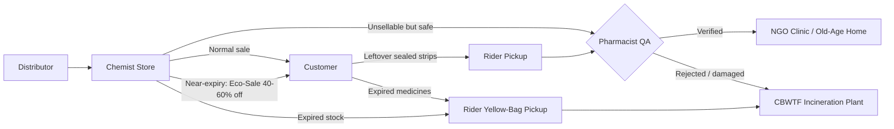
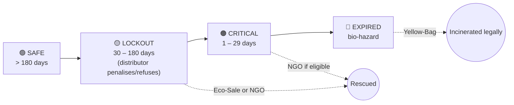
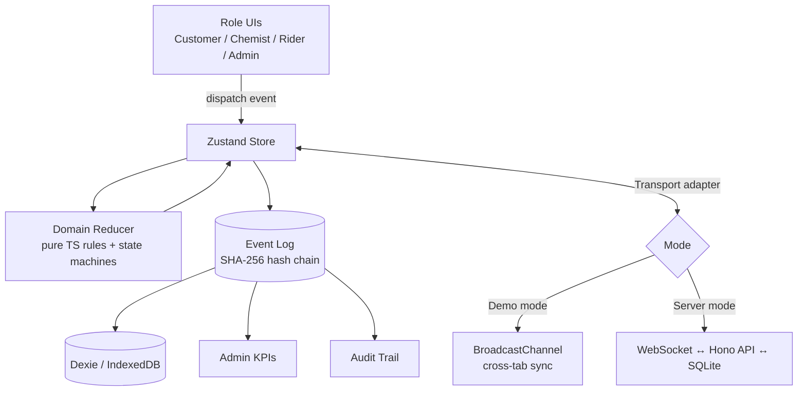

# 💊 PharmaFlow — pharma_flow_1

**Medicine reverse logistics, near-expiry liquidation and civic health on one platform.**

PharmaFlow replaces the one-way "buy → use → throw away" medicine supply chain with a **closed loop** that connects four roles: **Customers**, **local Medical Stores (Chemists)**, **Delivery Riders** and **Platform Admins / NGOs / Blood Banks**.

> 🎓 Project-Based Learning (PBL) project. Pilot region: **Mangaluru, Karnataka, India**.
> 🚧 Status: **design complete, build in progress** (see [Roadmap](#-roadmap)).

---

## 📑 Table of Contents

1. [The Problem](#-the-problem)
2. [The Solution](#-the-solution)
3. [How Medicine Flows Through PharmaFlow](#-how-medicine-flows-through-pharmaflow)
4. [The 4 Roles & Their Features](#-the-4-roles--their-features)
5. [Prescription Rules (Rx-Only Drugs)](#-prescription-rules-rx-only-drugs)
6. [Business & Safety Rules](#-business--safety-rules)
7. [Legal & Compliance Notes](#%EF%B8%8F-legal--compliance-notes)
8. [Technical Architecture](#%EF%B8%8F-technical-architecture)
9. [Tech Stack](#-tech-stack)
10. [Folder Structure](#-folder-structure)
11. [Getting Started](#-getting-started)
12. [Demo Walkthrough (for Evaluators)](#-demo-walkthrough-for-evaluators)
13. [Roadmap](#-roadmap)
14. [Research Basis](#-research-basis)
15. [Working on This Repo with an AI Assistant](#-working-on-this-repo-with-an-ai-assistant)

---

## 🔥 The Problem

### 1. Local chemists are losing money

These findings come from field visits and interviews with independent chemists:

| Pain point | Real-world impact |
|---|---|
| Legacy ERP licence (Marg, C-Square, PharmaSoft) | ₹10,000 – ₹12,000 upfront |
| Paywalled add-ons (barcode, expiry alerts, multi-terminal) | ₹14,000 – ₹15,000 extra |
| Annual Maintenance Charge (AMC) | ~₹8,000 every year → **~₹35,000 in year one** |
| Distributor 6-month return cutoff | Stock still safe to use is forced off the shelf early |
| 50% refund penalty | Half the money is lost even on returns made in time |
| Under 6 months left → return rejected | **100% write-off** |
| Refund paid as a credit note | Takes 60–90 days; no cash in hand |
| ERP vendors tied to distributors | Software pushes chemists to *buy more*, not to clear stock |
| No customer-facing channel | Near-expiry stock can't be sold to local buyers |
| No disposal pathway | Expired stock is written off on paper, not disposed of legally |

### 2. Households throw medicines away illegally

- Under the **Bio-Medical Waste Management Rules, 2016**, expired medicines are hazardous waste. They must go to a state-authorised **CBWTF** (Common Bio-Medical Waste Treatment Facility) for high-temperature incineration (1000–1200 °C) or encapsulation.
- In reality, **~73% of people throw leftover strips in the dustbin** and **~20% flush them** down sinks or toilets.
- Antibiotics and painkillers then leak into soil and groundwater and help breed **antimicrobial-resistant (AMR) "superbugs"**.

### 3. The paradox

Crores worth of **safe, unexpired** medicines sit unused in home cabinets and on chemist shelves, while **NGO clinics and old-age homes run short of basic drugs** and **blood banks run short of blood**.

---

## 💡 The Solution

| Problem | PharmaFlow feature |
|---|---|
| Expensive ERPs | **Free ERP for chemists**: ₹0 licence, ₹0 add-ons, ₹0 AMC |
| Distributor refuses returns | **Eco-Sale store**: chemists sell near-expiry stock to local customers at 40–60% off and get paid in cash immediately |
| Unused medicines at home | **Free doorstep pickup** → pharmacist QA check → **verified NGO clinic** |
| Expired medicines in the dustbin | **Yellow-Bag pickup** → **CBWTF incineration** with a disposal certificate |
| People don't take part | **Gamification**: Eco-Karma points, scratch cards, certificates |
| Blood shortages | **Blood bank connect**: live urgent requirements + appointment booking |
| No trust or traceability | **Tamper-evident audit ledger** for every action |

---

## 🔄 How Medicine Flows Through PharmaFlow



### Lifecycle of a single batch (by days of shelf life left)



---

## 👥 The 4 Roles & Their Features

### 1️⃣ Customer App (mobile-style, white clinical theme)

| Feature | Details |
|---|---|
| **Medicine catalog** | 12+ everyday Indian medicines (Dolo 650, Augmentin 625 Duo, Pan-D, Okacet, Azithral 500, Shelcal 500, Becosules, Benadryl Syrup, Electral ORS, Volini Gel, Limcee, Accu-Chek strips) with salt, pack size, manufacturer and MRP |
| **Cheaper generic switcher** | Shows a variant with the **same salt and same strength**, priced against **Jan Aushadhi (PMBJP)**. Example: Pan-D ₹190 → Pantoprazole + Domperidone generic ₹68 (save ₹122) |
| **Prescription upload** | Required for Rx-only drugs. See [Prescription Rules](#-prescription-rules-rx-only-drugs) |
| **Eco-Sale store** | Near-expiry stock at 40–60% off with an amber countdown badge, e.g. *"Expires in 38 days • fits a 5-day course • 50% OFF"*. Two buttons: **Buy for myself** or **Sponsor batch for NGO (₹99)** |
| **Civic Impact Hub** | **A.** Donate unused medicines to an NGO · **B.** Safe disposal of expired medicines · **C.** Donate blood |
| **Course-completion reminder** | *"Finished your 5-day course of Dolo 650? Donate the 10 unopened tablets left to Seva NGO Clinic and earn karma."* |
| **Live GPS tracker** | Map with store, home, NGO and CBWTF plant, plus an animated rider and a 4-step progress stepper |
| **Rewards wallet** | Eco-Karma points, MedWallet store credit and real `<canvas>` scratch cards (scratch >40% → confetti + reward) |
| **Certificates** | NGO Donor, Green Citizen (safe disposal) and Blood Donor certificates as PDF with a QR verification code |

### 2️⃣ Chemist Dashboard (zero-AMC ERP)

| Feature | Details |
|---|---|
| **Savings header** | "₹0 licence • ₹0 add-ons • ₹0 AMC — saved ₹35,000/yr vs legacy ERPs" |
| **Profit calculator** | Distributor return (50% credit note, ₹0 under 6 months) vs PharmaFlow Eco-Sale (50–70% in cash) |
| **Barcode scan-to-ingest** | Camera scanning with **GS1 parsing**: GTIN (01), **batch (10)** and **expiry (17)** are filled in automatically, and brand, salt, generic and MRP come from the catalog. Preset barcodes work when there's no camera |
| **Expiry ledger** | Colour-coded buckets: Safe / Lockout / Critical / Expired |
| **3 one-click actions per batch** | **Put on Eco-Sale** · **Donate to NGO** · **Schedule CBWTF disposal** |
| **Write-off certificate** | *Inventory Write-Off & NGO Donation Receipt* that includes the **GST ITC reversal** amount (CGST Sec 17(5)(h)) |
| **Order packing desk** | Review orders and **approve or reject prescriptions** before **Pack & Summon Rider** |
| **Returned-medicine QA desk** | Inspect seal, batch and expiry of donated strips → **QA Verified – Release to NGO** or **Reject – send to Bio-Disposal** |

### 3️⃣ Rider App (dark mode, built for outdoor use)

| Feature | Details |
|---|---|
| **Shift header** | Online/offline toggle, today's earnings, green incentives, trips completed |
| **3-colour mission radar** | 🔵 Forward delivery · 🟢 NGO reverse pickup · 🟠 Yellow-Bag bio-hazard pickup |
| **Navigation** | Dark map, multi-stop route, distance, ETA, call button |
| **Lifecycle buttons** | Large buttons: Accept → Arrived → Collected → Confirm Handover (OTP) |
| **Backhaul optimisation** | After a delivery, suggests any pending pickup at the same address or street, so a return is collected on the same trip at no extra fuel cost |

### 4️⃣ Admin & Regulatory Portal

| Feature | Details |
|---|---|
| **Pharmacy KYC** | New stores start as `PENDING_KYC`. Admin reviews the Drug Licence (e.g. `KA-MNG-2026-8841`) and GSTIN → **Approve** / **Reject** |
| **Impact KPIs** | ₹ dead stock recovered, kg of hazardous waste diverted, ₹ of medicines sent to NGOs, blood donations booked |
| **Audit trail** | Every event in a **SHA-256 hash-chained ledger** + **Verify Ledger Integrity** button |

---

## 📋 Prescription Rules (Rx-Only Drugs)

Some medicines **cannot be bought without a valid prescription** from a registered doctor. PharmaFlow enforces this in code; the UI alone isn't trusted.

### Drug categories used by the app

| Category | Examples in our catalog | Prescription needed? | What PharmaFlow does |
|---|---|---|---|
| **OTC / general** | Dolo 650, Shelcal 500, Becosules, Electral ORS, Volini Gel, Limcee, Accu-Chek strips | ❌ No | Add to cart and check out directly |
| **Schedule H** (Rx-only) | Pan-D (Pantoprazole + Domperidone), Augmentin 625 Duo, Azithral 500 | ✅ Yes | Rx upload required, chemist must approve before packing |
| **Schedule H1** (stricter: certain antibiotics, anti-TB and habit-forming drugs) | *(none in the demo catalog yet; the rule engine supports it)* | ✅ Yes + register entry | Rx required, and every sale is logged in an **H1 register** (patient, doctor, drug, quantity) kept for 3 years |
| **Schedule X / NDPS** (narcotics, psychotropics) | — | 🚫 Not sold | **Blocked on the platform** completely: cannot be sold, donated or listed |

> ⚠️ Drug classifications in the seed data are for demo purposes. Check them against the latest CDSCO / Drugs & Cosmetics Rules schedules before any real deployment.

### Prescription flow

```mermaid
sequenceDiagram
    participant U as Customer
    participant A as PharmaFlow
    participant C as Chemist
    participant R as Rider
    U->>A: Adds Augmentin (Schedule H) to cart
    A-->>U: "Prescription required" (checkout locked)
    U->>A: Uploads prescription photo
    A->>A: OCR (Tesseract.js) extracts doctor name, reg. no., date, patient, drug
    A->>A: Auto-checks: readable? drug listed? date valid?
    A->>C: Order arrives in Packing Desk with Rx image + extracted fields
    alt Chemist approves
        C->>A: Approve Rx
        A->>A: Order moves to PACKED (H1 drugs also written to the H1 register)
        A->>R: Rider summoned
    else Chemist rejects
        C->>A: Reject (reason: unreadable / expired / wrong drug)
        A-->>U: Notified, may re-upload; payment refunded if already paid
    end
```

### Rules the code enforces

1. An order with any Rx-only item **cannot move to `PACKED`** until the chemist has approved the prescription.
2. **OCR only reads the prescription; it never approves it.** The pharmacist always makes the final decision, as the law requires.
3. The prescription must show: doctor name, **registration number**, date, patient name and the prescribed drug.
4. Validity window is configurable (demo default: **30 days for antibiotics**, 180 days for others), and a **prescription for an antibiotic course is single-use**.
5. Quantity sold can't exceed what the prescription covers.
6. **Eco-Sale doesn't skip these rules**: a discounted Augmentin still needs a prescription.
7. **Donated Rx-only medicines** go only to NGO clinics that have a **registered doctor or pharmacist** on site.
8. Every approval and rejection is recorded in the audit ledger.

---

## 📏 Business & Safety Rules

All rules live in `/src/domain` as pure, unit-tested functions.

| Rule | Value |
|---|---|
| Expiry buckets | SAFE > 180 d · LOCKOUT 30–180 d · CRITICAL 1–29 d · EXPIRED ≤ 0 d |
| Eco-Sale discount | 40% – 60% |
| Eco-Sale eligibility | `days_left ≥ course_days + 15` (the patient must finish the course before the medicine expires) |
| NGO donation eligibility | Sealed/unopened, `days_left > 30`, **not** cold-chain (e.g. insulin), **not** Schedule X/NDPS, **not** opened liquids |
| Donated medicines | **Must pass chemist QA** before NGO handover; rejected items go to bio-disposal |
| Expired medicines | Only allowed route: Yellow-Bag → CBWTF incineration |
| Rewards | Donation +200 karma + 1 scratch card · Safe disposal +150 karma · Orders earn scratch cards |
| Blood donation rewards | +500 karma, certificate and badge **only**: no cashback or anything with money value |
| MedWallet | **Closed-loop store credit**, never converted to cash |

### Order & pickup lifecycles (state machines; invalid jumps are rejected)

```
Forward order:   PLACED → [RX_APPROVED] → PACKED → OUT_FOR_DELIVERY → DELIVERED
Reverse pickup:  SCHEDULED → COLLECTED → QA_VERIFIED → DELIVERED_TO_NGO
                                       ↘ QA_REJECTED → INCINERATED
Bio-disposal:    SCHEDULED → COLLECTED (sealed Yellow Bag) → INCINERATED
```

---

## ⚖️ Legal & Compliance Notes

| Area | How PharmaFlow handles it |
|---|---|
| **Drugs & Cosmetics Act 1940 / Rules 1945** | Schedule H/H1 need a prescription and pharmacist approval; Schedule X/NDPS are blocked |
| **Bio-Medical Waste Management Rules 2016** | Expired medicines go only to an authorised CBWTF (Yellow category) |
| **Solid Waste Management Rules 2016** | Household medicines are treated as domestic hazardous waste; the app explains this to users |
| **Medicine redistribution** | India has no explicit framework for re-dispensing household returns, so it runs as a **pharmacist-gated pilot** limited to sealed strips |
| **Income Tax (80G)** | In-kind (goods) donations **don't qualify** for 80G. We issue an inventory write-off record + NGO receipt instead |
| **GST — CGST Sec 17(5)(h)** | Input tax credit on goods written off, destroyed or given away must be reversed; the certificate calculates it |
| **Blood donation** | India's policy is voluntary and unpaid, so there are no money-value rewards |
| **RBI prepaid wallet rules** | MedWallet is closed-loop store credit (no cash-out) |

> This project is an academic prototype, not legal advice.

---

## 🏗️ Technical Architecture

### The core idea: everything is an event

Every action (scanning a batch, placing an order, approving a prescription, collecting a pickup) is stored as an **immutable domain event** in one event log.



Why this design:

- **One codebase, two modes.** Demo mode works with no setup; server mode reuses the same events and reducer.
- **Real-time sync comes free.** Events are broadcast to every open tab or client.
- **Audit trail and KPIs come free.** They're just views of the event log.
- **Tamper-evident.** Each event stores `sha256(prevHash + payload)`; changing any past event breaks the chain.
- **Time travel for demos.** Domain logic uses a **simulated clock**, so the presenter can jump forward 60 days and watch batches change bucket.

### Modes

| Mode | Storage | Sync | Setup |
|---|---|---|---|
| **Demo (default)** | IndexedDB (Dexie) | BroadcastChannel between tabs | None: `npm run dev` |
| **Server (later)** | SQLite (better-sqlite3 + Drizzle) | WebSockets (`ws`) | Node.js only |

### Planned REST API (server mode)

| Endpoint | Purpose |
|---|---|
| `POST /api/auth/login`, `/register` | Email + password (bcrypt, JWT in httpOnly cookie) |
| `/api/inventory` | Batches, scans, expiry buckets |
| `/api/orders` | Forward orders + prescription approval |
| `/api/donations` | NGO donations, QA, bio-disposal |
| `/api/blood-drives` | Blood requirements + bookings |
| `/api/admin` | KYC, KPIs, ledger verification |
| `/api/events` | Event stream / replay |

---

## 🧰 Tech Stack

| Layer | Choice |
|---|---|
| Language | **TypeScript** |
| Framework / build | **React 18 + Vite** |
| Routing | **React Router 7** (`/customer`, `/chemist`, `/rider`, `/admin`, `/presenter`) |
| State | **Zustand** |
| Browser storage | **Dexie.js** (IndexedDB) |
| Validation | **Zod** |
| UI | **Tailwind CSS + shadcn/ui (Radix) + Lucide icons + Framer Motion** |
| Barcode | **@zxing/browser** + GS1 parser |
| Prescription OCR | **Tesseract.js** |
| Maps | **react-leaflet + OpenStreetMap** (CartoDB Dark for riders), SVG fallback |
| Scratch cards | HTML5 `<canvas>` (`destination-out`) + **canvas-confetti** |
| Certificates | **jsPDF + qrcode** |
| Charts | **Recharts** |
| Server (later) | **Hono / Fastify + better-sqlite3 + Drizzle ORM + ws** |
| PWA / i18n | **vite-plugin-pwa**, **react-i18next** (English, ಕನ್ನಡ, हिन्दी) |
| Testing | **Vitest** (domain rules) + **Playwright** (multi-tab sync) |
| Hosting | Vercel / Netlify (demo) · Render / Railway (server) |

### Design tokens

| Token | Colour | Used for |
|---|---|---|
| Medical Blue | `#0284C7` | Commerce, orders |
| Emerald | `#10B981` | Eco / NGO actions |
| Amber | `#F59E0B` | Expiry countdowns |
| Crimson | `#E11D48` | Blood donation |
| Background | `#F8FAFC` / cards `#FFFFFF` | Customer app |
| Rider | `bg-slate-950` | Dark mode for the field |

---

## 📁 Folder Structure

```
pharma_flow_1/
├── src/
│   ├── domain/          # Pure TS: types, Zod schemas, events, reducer, rules, state machines
│   │   ├── events.ts
│   │   ├── reducer.ts
│   │   ├── rules/       # expiry.ts, ecoSale.ts, donation.ts, prescription.ts, rewards.ts, gst.ts
│   │   └── machines/    # order.ts, pickup.ts
│   ├── store/           # Zustand store, Dexie persistence, transport (BroadcastChannel / WS)
│   ├── roles/
│   │   ├── customer/
│   │   ├── chemist/
│   │   ├── rider/
│   │   └── admin/
│   ├── components/      # Shared UI (PresenterBar, ScratchCard, Map, Stepper, CertificatePDF…)
│   ├── seed/            # Demo medicines, stores, NGOs, blood banks, users
│   └── main.tsx
├── server/              # (later) Hono API + SQLite
├── tests/               # Vitest + Playwright
└── README.md            # Full project documentation + AI brief
```

---

## 🚀 Getting Started

> These commands will work once the scaffold is committed (Roadmap step 1).

```bash
git clone https://github.com/chethan-9817/pharma_flow_1.git
cd pharma_flow_1
npm install
npm run dev
```

Then open, **each in its own tab**:

- `http://localhost:5173/customer`
- `http://localhost:5173/chemist`
- `http://localhost:5173/rider`
- `http://localhost:5173/admin`

…or `http://localhost:5173/presenter` to see all four side by side.

Use the **1-tap demo login** buttons; no sign-up is needed.

---

## 🎬 Demo Walkthrough (for Evaluators)

All of this happens **live across 4 tabs without a page refresh**:

1. **Chemist** scans a batch of Dolo 650 → it lands in **SAFE**.
2. Presenter drags the **Time-Travel slider** +5 months → the batch moves to **LOCKOUT** (amber).
3. **Chemist** clicks **Put on Eco-Sale** → the batch **instantly appears** in the Customer Eco-Sale tab at 50% off.
4. **Customer** adds Eco-Sale Dolo + **Augmentin** → checkout is **locked: prescription required** → uploads an Rx → OCR fills in the fields.
5. **Chemist** reviews and **approves the Rx** → **Pack & Summon Rider**.
6. **Rider** sees a 🔵 mission → Accept → Collected → Delivered (OTP). The **backhaul** prompt shows a pending 🟢 donation pickup next door.
7. **Customer** gets a **scratch card** → scratches → confetti + reward.
8. **Customer** donates leftover strips → **Rider** collects → **Chemist QA** verifies → handed over to the NGO → **Donor certificate** PDF with QR.
9. **Admin** sees the KPIs update and clicks **Verify Ledger Integrity** → ✅ chain intact.

---

## 🗺️ Roadmap

- [ ] **1. Domain core:** types, events, reducer, rules (incl. prescription), state machines + Vitest tests
- [ ] **2. Store & sync:** Zustand + Dexie + BroadcastChannel, presenter bar, time travel, seed data
- [ ] **3. Chemist:** scan → expiry ledger → Eco-Sale / Donate / Dispose → write-off certificate
- [ ] **4. Customer:** catalog, generic switch, Eco-Sale, cart, **Rx upload + OCR**, checkout, scratch card
- [ ] **5. Rider:** mission radar, lifecycle buttons, map, backhaul
- [ ] **6. Civic Hub:** donate, dispose, blood booking, certificates, course-end reminder
- [ ] **7. Admin:** KYC queue, KPI charts, hash-chained audit trail
- [ ] **8. Extras:** server mode, PWA, i18n (en/kn/hi), Playwright multi-tab test

---

## 📚 Research Basis

| Source | Finding | Feature |
|---|---|---|
| Jose & Surendran (2025) | Awareness, incentives and shared roles drive medicine returns | Karma points, scratch cards, certificates |
| Wickens et al. (2024) | Returned medicines can be reused if inspected and regulated | Pharmacist QA desk + audit trail |
| Kanyari (2024); IJCMPH (2024, 2025) | Households bin or flush drugs because pharmacies won't take them back | Free doorstep rider pickup |
| Sorensen et al. (2024, Denmark) | Barcode scanning cuts expiry-check time by 59% | GS1 scan-to-ingest + expiry ledger |
| PharmaSwap; NCSL (2025) | Near-expiry and repository programmes fail on manual paperwork | Unified digital Eco-Sale + NGO intake |

---

## 🤖 Working on This Repo with an AI Assistant

If you use an AI coding assistant on this project, paste the brief below as your first message. It keeps the AI aligned with every decision in this README. This README is the single source of truth for the project.

<details>
<summary><b>Click to expand the AI project brief</b></summary>

```markdown
# PROJECT BRIEF — PharmaFlow (read fully before writing any code)

## 1. What you are building
A web app closing the medicine loop in Mangaluru, India, connecting 4 roles:
CUSTOMER (buy, buy near-expiry at discount, donate leftovers, dispose expired, book blood donation),
CHEMIST (free ERP: scan stock, expiry ledger, liquidate via Eco-Sale / NGO / bio-disposal, approve prescriptions),
RIDER (forward deliveries + reverse pickups),
ADMIN (pharmacy KYC, KPIs, tamper-evident audit ledger).
College PBL demo. Must run with ZERO setup: `npm install && npm run dev`. No cloud, no API keys.

## 2. Fixed decisions (do not change or re-debate)
TypeScript, React 18, Vite, React Router 7, Tailwind, shadcn/ui, Lucide, Framer Motion,
Zustand, Dexie, Zod. Event-sourced core: every action is a typed event; state = reduce(events).
Sync via BroadcastChannel (demo mode). Server mode (Hono + SQLite + ws) LATER, same events/reducer.
Routes: /customer /chemist /rider /admin /presenter.
Libs: @zxing/browser, Tesseract.js, react-leaflet, jsPDF + qrcode, Recharts, canvas-confetti.
Folders: src/domain (pure TS) | src/store | src/roles/<role> | src/components | src/seed.

## 3. Domain rules (exact; all in src/domain; all unit-tested)
- Buckets by simulated days_left: SAFE >180 | LOCKOUT 30-180 | CRITICAL 1-29 | EXPIRED <=0.
- Eco-Sale: 40-60% off; sellable only if days_left >= course_days + 15; never EXPIRED.
- Donation: sealed, days_left > 30, not cold-chain, not Schedule X/NDPS, not opened liquids;
  must pass chemist QA; rejected -> bio-disposal.
- Expired -> Yellow-Bag -> CBWTF only.
- PRESCRIPTIONS: drugs have schedule OTC | H | H1 | X.
  H and H1 need an uploaded Rx; OCR only extracts fields; CHEMIST must approve before PACKED.
  H1 sales also written to an H1 register. X/NDPS are blocked everywhere.
  Rx must have doctor name, reg no, date, patient, drug. Validity: 30 d antibiotics, 180 d others.
  Antibiotic Rx single-use. Qty <= prescribed. Eco-Sale does NOT bypass Rx.
  Donated Rx-only drugs go only to NGOs with a registered doctor/pharmacist.
- Generic label: "Same salt, same strength" (never "certified bioequivalent").
- Rewards: donation +200 karma + scratch card; disposal +150; blood +500 karma + certificate ONLY
  (no money-value rewards). MedWallet = closed-loop credit, no cash-out.
- Write-off cert = "Inventory Write-Off & NGO Donation Receipt" with GST ITC reversal
  (CGST 17(5)(h)). Never call it 80G.
- State machines (reject invalid transitions):
  Order: PLACED -> [RX_APPROVED] -> PACKED -> OUT_FOR_DELIVERY -> DELIVERED
  Pickup: SCHEDULED -> COLLECTED -> QA_VERIFIED|QA_REJECTED -> DELIVERED_TO_NGO|INCINERATED
- New chemists start PENDING_KYC; cannot list stock until ADMIN approves.
- Ledger: each event stores sha256(prevHash + payload) via Web Crypto; admin can verify.
- Barcode: parse GS1 AIs 01 GTIN, 10 batch, 17 expiry (YYMMDD); preset fallback.

## 4. Design
Customer: phone frame, white theme; blue #0284C7 commerce, green #10B981 eco,
amber #F59E0B expiry, crimson #E11D48 blood. Chemist/Admin: dense dashboards.
Rider: dark (bg-slate-950), big buttons. Presenter bar everywhere: role switch,
1-tap demo logins, time-travel slider, reset demo data.

## 5. Do NOT
No Supabase/Firebase/paid/cloud/API-key services. No fake "AI verified" claims.
No Date.now() in domain logic (use simulated clock). No business rules in React components.
No unlisted features without asking. Don't rewrite working modules.

## 6. Build order: follow the README Roadmap, one step at a time.

## 7. Done = README "Demo Walkthrough" works across 4 tabs without refresh.

## 8. How to work with me
Plan first (files to touch), then complete files (no "...rest unchanged"),
then tell me how to run/check it. If a rule is unclear, ASK.
```

</details>

---

## 👤 Author

**Chethan** — [@chethan-9817](https://github.com/chethan-9817)

*This project is all about medicine reverse logistics: making sure every strip of medicine ends up helping someone or being destroyed safely, never in a dustbin or a drain.*
