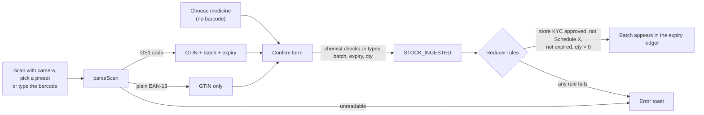
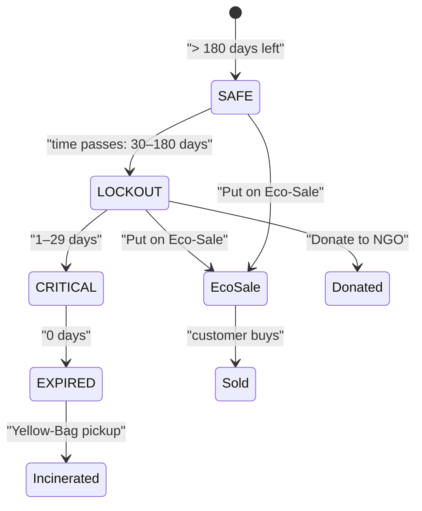
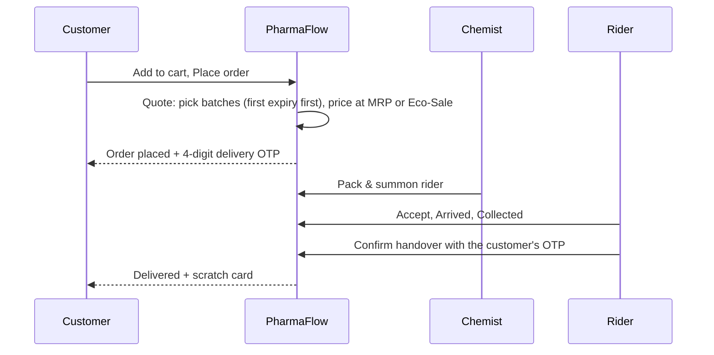
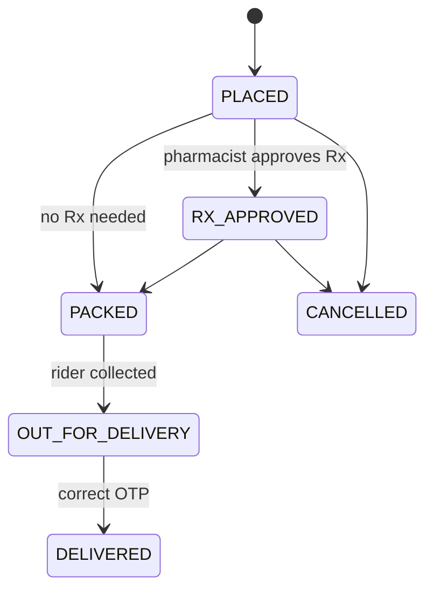
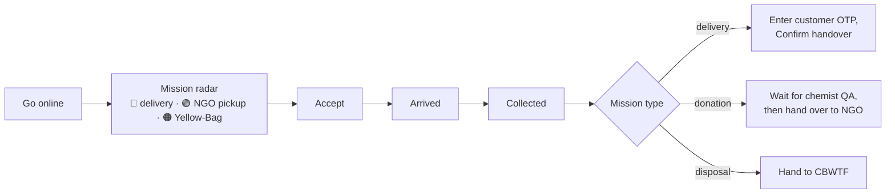
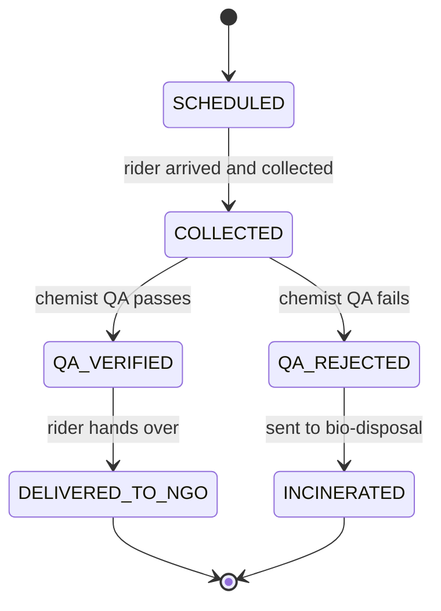
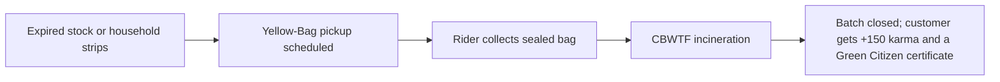
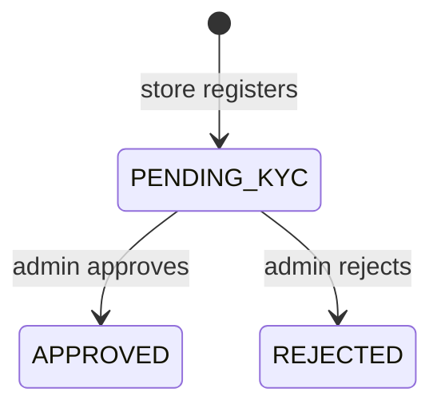
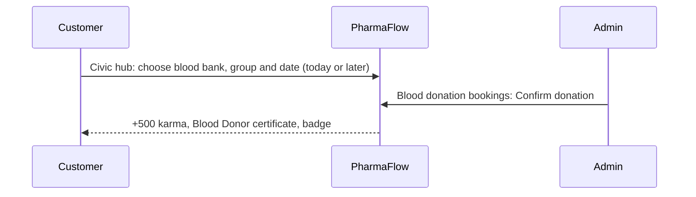
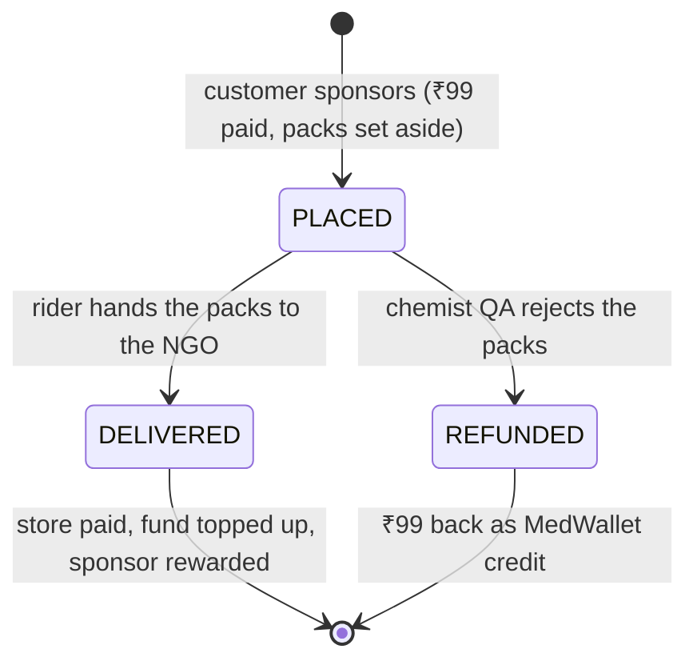

# PharmaFlow Workflows

Every business flow in PharmaFlow, who does what, and which rule can stop it. For how the code is organised see [ARCHITECTURE.md](ARCHITECTURE.md).

## Contents

1. [Who can do what](#who-can-do-what)
2. [Flow status at a glance](#flow-status-at-a-glance)
3. [Stock arrives: scan to ingest](#1-stock-arrives-scan-to-ingest)
4. [Eco-Sale: rescuing near-expiry stock](#2-eco-sale-rescuing-near-expiry-stock)
5. [Buying: forward order (OTC)](#3-buying-forward-order-otc)
6. [Buying with a prescription](#4-buying-with-a-prescription)
7. [Delivery by a rider](#5-delivery-by-a-rider)
8. [Donating medicines to an NGO](#6-donating-medicines-to-an-ngo)
9. [Disposing of expired medicines](#7-disposing-of-expired-medicines)
10. [Pharmacy KYC](#8-pharmacy-kyc)
11. [Blood donation](#9-blood-donation)
12. [Rewards and certificates](#10-rewards-and-certificates)
13. [Time travel](#11-time-travel)
14. [Sponsoring a batch for an NGO, and the NGO fund](#12-sponsoring-a-batch-for-an-ngo-and-the-ngo-fund)
15. [Demo script](#demo-script)
16. [Developer workflow](#developer-workflow)
17. [Troubleshooting](#troubleshooting)

---

## Who can do what

| Role | Demo login | Can do |
|---|---|---|
| **Customer** | Asha Shetty, Ravi Kumar | Browse, buy, upload prescriptions, cancel orders, reveal scratch cards, donate, dispose, book blood, sponsor an Eco-Sale batch for an NGO |
| **Chemist** | Ganesh Prabhu (Sri Ganesh Medicals) | Ingest stock, Eco-Sale, donate and dispose batches, review prescriptions, pack orders, run the QA desk (including sponsored packs) |
| **Rider** | Kiran Poojary | Go online, accept and complete deliveries and pickups |
| **Admin** | PharmaFlow Admin | Approve or reject pharmacies, verify the ledger (the domain also lets admins confirm blood donations; screen to come) |

The reducer enforces these roles. For example, only a chemist of the same store can pack that store's orders.

## Flow status at a glance

| Flow | Rules and events | Screens |
|---|---|---|
| Add inventory (scan, type or choose medicine) | ✅ | ✅ |
| Eco-Sale | ✅ | ✅ |
| OTC order | ✅ | ✅ |
| Prescription order and OCR | ✅ | ✅ |
| Rider delivery with OTP | ✅ | ✅ |
| Rider navigation map, ETA and Call | ✅ | ✅ dark street map, offline route diagram |
| Chemist donates or disposes a batch | ✅ | ✅ |
| Customer donates or disposes (Civic hub) | ✅ | ✅ |
| Backhaul pickup suggestion | ✅ | ✅ appears when a customer-scheduled pickup is within about 600 m of a delivery |
| Pharmacy KYC | ✅ | ✅ |
| Blood booking and confirmation | ✅ | ✅ customer booking in the Civic hub; admin confirmation |
| Scratch cards | ✅ | ✅ canvas scratch with confetti, and a Reveal button |
| Certificates | ✅ | ✅ PDF with a QR code, plus a verify page |
| Write-off receipts for chemists | ✅ | ✅ PDF with the GST ITC reversal |
| Live order tracker for customers | ✅ | ✅ stepper, map, moving rider and ETA |
| Admin charts | ✅ | ✅ stock health, money recovered, platform activity |
| "Sponsor batch for NGO (₹99)" | ✅ | ✅ Deals card, Civic hub tracking, chemist QA badge and payout list |
| NGO fund | ✅ | ✅ Admin card and chart line; customers see their order's share. Spending it is not built yet |

---

## 1. Stock arrives: add inventory

**Actor:** Chemist. **Screen:** Chemist → *Add inventory* (also reachable from the **Add inventory** buttons in the shop header and above the expiry ledger). Choose a tab: **Scan barcode**, **Type barcode** or **Choose medicine**.



Notes:

- GS1 codes carry the product code (GTIN), batch (AI 10) and expiry (AI 17, `YYMMDD`; day `00` means end of month). A plain retail barcode carries only the GTIN, so the chemist types the batch and expiry.
- A GTIN that is not in the catalog is rejected with its number shown.
- **No barcode at all?** Use the **Choose medicine** tab: pick the medicine from the catalog, then type the batch number and expiry printed on the strip.
- **If the camera cannot read the strip, or there is no camera, type it.** Put the digits under the barcode into **Can't scan? Type the barcode** and press **Look up**. Spaces and hyphens are ignored, and a wrong digit count gets a clear message. A GS1 string such as `(01)08901234500011(17)270600(10)DL27A01` also works and fills batch and expiry. The camera dialog offers "Type the barcode instead" when it fails and after a few seconds without a read.
- Stock cannot be added by a store that is still `PENDING_KYC`.

## 2. Eco-Sale: rescuing near-expiry stock

**Actor:** Chemist, then customers.



| Rule | Value |
|---|---|
| Discount | 40% to 60%. The button suggests 60% under 45 days left, 50% under 90 days, otherwise 40% |
| Eligibility | `days_left ≥ course_days + 15`, so the patient can finish the course before expiry |
| Never | Expired stock, Schedule X |
| Prescription | **Not bypassed.** An Eco-Sale Augmentin still needs a prescription |
| Over time | If time travel makes the course no longer fit, the deal disappears and cannot be bought |

Customers see: *Expires in 38 days • fits a 5-day course • 50% OFF*.

## 3. Buying: forward order (OTC)





- Stock is **reserved** when the order is placed and put back if the order is cancelled.
- Cancelling also refunds any MedWallet credit used.
- Payment is on delivery. MedWallet credit is applied at checkout.
- **Live tracking:** under *Orders*, an open order shows a 4-step progress bar (Placed, Packed, On the way, Delivered). Once a rider accepts it, a map shows the pharmacy, your home and the rider, with an ETA. The rider's movement is a simulation, not GPS.

## 4. Buying with a prescription

Schedule H and H1 drugs need a prescription. Schedule X / NDPS drugs are blocked completely.

```mermaid
sequenceDiagram
    participant U as Customer
    participant O as OCR (Tesseract)
    participant A as PharmaFlow rules
    participant C as Chemist
    U->>A: Cart has a Schedule H drug
    A-->>U: Checkout needs a prescription
    U->>U: Upload photo
    U->>O: Read with OCR (optional, internet needed once)
    O-->>U: Suggested doctor, reg. no., date, patient, quantities
    U->>U: Check and correct the fields
    U->>A: Place order with prescription
    A->>A: Auto-checks: fields present, drug listed, date valid, quantity covered, antibiotic Rx unused
    A->>C: Order lands in the packing desk with the Rx details
    alt Chemist approves
        C->>A: Approve Rx
        A->>A: Order becomes RX_APPROVED; H1 lines go to the H1 register when packed
        C->>A: Pack & summon rider
    else Chemist rejects
        C->>A: Reject with a reason
        A-->>U: Order stays open; upload a new prescription
        U->>A: Send new prescription
    end
```

Rules the reducer enforces:

1. Required on the prescription: doctor name, **registration number**, date, patient name, the drug.
2. Validity: **30 days for antibiotics, 180 days for other drugs**. Validity is checked again at approval, so time travel matters.
3. An **antibiotic prescription is single-use**. A non-antibiotic one can cover more orders.
4. Quantity ordered cannot exceed the quantity prescribed.
5. A prescription cannot be dated in the future.
6. **OCR only suggests.** The pharmacist approves or rejects, and the order cannot reach `PACKED` without approval.
7. Eco-Sale does not skip any of this.
8. Every approval and rejection is recorded in the audit ledger.

## 5. Delivery by a rider

**Actor:** Rider. **Screen:** Rider (dark mode).



- **Navigation:** as soon as a rider has a mission, a dark street map shows every stop in order (store or pickup point, then the customer, QA store, NGO or CBWTF plant) as numbered pins, with the rider as a pulsing yellow dot. Below it: the next stop, distance, ETA (at about 25 km/h), a **Call** button (a made-up demo number) and an **Open in Maps** link. After a backhaul pickup is added the route simply grows. The dot glides toward the next stop while the rider is travelling and waits when the rider has arrived.
- **Offline:** if the device loses internet, or street tiles keep failing, the map switches to a plain route diagram with the same stops and ETA, and returns when the connection is back.
- A rider must be **online** to accept. A rider cannot go offline with an active mission.
- Only the assigned rider can progress a mission.
- A wrong OTP is rejected and the order stays out for delivery.
- **Pay (demo values):** ₹40 per delivery; ₹30 per pickup plus a ₹10 green incentive.
- **Backhaul:** while delivering, the rider is shown any unassigned pickup within about 600 m of the customer, so a return is collected on the same trip.

## 6. Donating medicines to an NGO



**Eligibility** (checked when scheduling, and again at the QA desk):

- Sealed and unopened, and not an opened liquid.
- **More than 30 days** of shelf life left. Time passes while a pickup is in transit, so the QA desk checks again.
- Not cold-chain (for example insulin) and not Schedule X.
- **Prescription-only drugs go only to NGOs with a registered doctor or pharmacist.** Seva NGO Clinic qualifies; Karunya Old-Age Home does not.

**Who starts it:**

- A **chemist** donates a whole batch (the *Donate* button). The chemist's own store runs QA.
- A **customer** donates leftover strips from **Civic hub → Donate unused medicines**: choose the medicine, type the batch and expiry, tick sealed, pick the NGO and the pharmacy that checks the strips. The form warns live ("no registered doctor or pharmacist", "needs more than 30 days") and only enables the button when the rules pass. A **course-completion reminder** ("Finished your 5-day course of Dolo 650? Donate the unopened tablets left…") appears on the Civic hub once the course length has passed on the simulated clock, with a button that pre-fills the form.

**Outcomes:**

| Result | What happens |
|---|---|
| QA verified, delivered | Batch closed. If a customer donated: +200 karma, a scratch card and an NGO Donor certificate. Rider earns pickup pay |
| QA rejected | Goes to incineration. **No** donor reward. Rider earns pickup pay |

## 7. Disposing of expired medicines

Expired medicines have exactly one legal route: **Yellow Bag → CBWTF incineration**.



- Only **expired** items can be scheduled; anything still in date is pointed to donation instead.
- Schedule X items are blocked on the platform.
- A chemist's expired batch shows a red *Dispose* button.

## 8. Pharmacy KYC



- New stores **must** start as `PENDING_KYC`.
- A pending or rejected store cannot list stock, sell, or receive pickups. Customers only see approved stores.
- Only an admin can decide, and each store is reviewed once.
- The admin sees the drug licence (for example `KA-MNG-2026-9102`) and GSTIN.

## 9. Blood donation



India's policy is voluntary, unpaid blood donation, so the reward has **no money value**: no cashback, no scratch card, no wallet credit. The blood bank cards show each bank's **urgent blood groups**.

## 10. Rewards and certificates

| Action | Reward |
|---|---|
| Delivered order | Scratch card |
| Donation to an NGO (customer) | +200 karma, scratch card, NGO Donor certificate |
| Sponsoring a batch for an NGO | The same: +200 karma, scratch card, NGO Donor certificate (worded as sponsoring), earned when the NGO has the packs. A failed pharmacist check gives the ₹99 back as MedWallet credit instead |
| Safe disposal (customer) | +150 karma, Green Citizen certificate |
| Blood donation | +500 karma, Blood Donor certificate, badge |

**Scratch cards** are real: drag a mouse or finger across the silver coating. Once more than 40% is clear, the reward is revealed and confetti plays. A *Can't scratch? Reveal* button covers keyboard users. Cards give either karma or **MedWallet** credit, and the reward is fixed by the card id, so replaying the log always gives the same result. MedWallet is closed-loop store credit: it can be spent at checkout and can never be cashed out.

**Certificates** are listed under *Civic hub → My certificates* with a **PDF** button. Each PDF has the holder's name, the date, a verification code and a **QR code** that opens `/verify?code=…`. That page shows whether the code is valid and who it was awarded to. In demo mode it checks the data stored in the same browser.

**Chemist write-off receipts.** When a donation reaches an NGO, or expired stock is incinerated, the chemist's dashboard lists an *Inventory Write-Off & NGO Donation Receipt* with a **PDF** button. It shows each batch, its estimated cost value and the **GST ITC reversal** (CGST Sec 17(5)(h), 12% by default). It is never called an 80G receipt.

## 11. Time travel

The presenter bar moves the simulated date **forward only**: drag the slider or use +1 week, +1 month or +5 months.

What changes as the date moves:

- Batches move between SAFE, LOCKOUT, CRITICAL and EXPIRED.
- Eco-Sale deals vanish once the course no longer fits.
- Prescriptions and donation shelf life are re-checked when approved or verified.
- Seed stock expires quickly. After +5 months most of the starting inventory is expired, which is useful for showing disposal.

**Reset demo** clears everything in every open tab and returns the date to 8 Nov 2026.

## 12. Sponsoring a batch for an NGO, and the NGO fund

**Actors:** Customer (sponsors), the store's chemist, a rider, the NGO. **Screen:** Customer → *Deals* → **Sponsor batch for NGO (₹99)** on any card.



1. The customer picks the NGO. The panel shows exactly what happens, for example: *"₹99 sponsors 10 packs for Seva NGO Clinic. ₹92 pays Sri Ganesh Medicals at the Eco-Sale price. ₹7 tops up the NGO fund."* The numbers come from the same rule the reducer re-checks.
2. The packs are set aside from the store's batch at once, and a rider mission appears **at the store** (not at the customer's home).
3. The rider accepts, arrives and collects. The chemist's **QA desk** then shows the packs with a *Sponsored* badge and the payout they will earn.
4. **QA verified** → the rider hands them to the NGO. **QA rejected** → the packs go to bio-disposal and the sponsor is refunded.

**What changes when the NGO has the packs**

| Who | What |
|---|---|
| Store | Paid the Eco-Sale price of the packs. Shown under *Sponsored for NGOs* on the chemist dashboard (packs delivered, paid, still on the way) |
| NGO fund | The change (for example ₹7) is added |
| Sponsor | +200 karma, a scratch card, and an **NGO Donor certificate** that says *Sponsored 10 packs of Okacet for Seva NGO Clinic* |
| Rider | Pickup pay, like any pickup |
| Admin | *Medicines to NGOs* counts the packs at MRP; the NGO fund card and chart line step up |

**Rules that can stop it**

- Only an **Eco-Sale** batch, only **OTC** medicines (a prescription-only deal shows *"needs a prescription, so only over-the-counter medicines can be sponsored"*), not cold-chain, and **more than 30 days** of shelf life left because the packs go on to an NGO.
- A pack that costs more than ₹99, or an empty batch, cannot be sponsored.
- If the batch has fewer packs left than ₹99 would buy, the sponsor gets those packs and the change in the fund is larger.
- It is a **sale** to the sponsor, so the store gets no donation write-off receipt or GST ITC reversal for these packs. (Rejected packs are written off as bio-disposal, as usual.)

**The NGO fund** is closed-loop money for medicines for NGOs, never cash. Two things feed it: sponsor change, and **2% of the platform's 10% fee on every delivered order** (demo values in `src/domain/rules/fund.ts`; the chemist's payout is never reduced). The Admin dashboard shows its balance, where it came from and recent entries. After a delivery the customer's order card says how much went in.

**Not built yet (designed):** an NGO login with a *needs list*, a chemist **NGO price** opt-in, and bulk buying from distributors at a cheaper rate, all paid from this fund. See [TODO.md](TODO.md).

---

## Demo script

About 8 to 10 minutes. Everything happens live across tabs with no refresh.

### Before you start (2 minutes, with wifi on)

| Check | How |
|---|---|
| App is running | Type `pharmaflow` in any terminal. It starts the app and opens `http://localhost:5173/presenter` (or double-click `Start PharmaFlow.cmd`) |
| **Use `localhost`** | The camera is blocked on plain-HTTP LAN addresses |
| Warm up OCR **once** | In a Customer tab, add Augmentin to the cart, upload any photo and press **Read with OCR**. This downloads about 10 MB and caches it |
| Rider map | Needs internet for street tiles. If wifi drops it falls back to a route diagram, so the demo keeps going |
| Camera permission | Press **Scan with camera** once and click Allow |
| QR codes ready | Open `http://localhost:5173/demo-barcodes` on a phone (or print it) |
| Clean slate | Press **Reset demo** in the presenter bar |
| Layout | Use the **All 4** view, or four browser windows side by side |

Log in with the 1-tap buttons: Asha (Customer), Ganesh (Chemist), Kiran (Rider), Admin.

### Laptop view or All 4

- **One role on its own** (the role tabs in the top bar) gives the roomy **laptop layout**: the customer has a sidebar and a multi-column shop and cart, the rider has the missions on the left and a large map on the right.
- **All 4** shows the compact **phone-style panes** side by side, so the whole loop is visible at once. Use it for step-by-step storytelling; switch to a single role to show one screen at full size.

### The walkthrough

| # | Where | Do | Say / expected result |
|---|---|---|---|
| 1 | Chemist | **Scan with camera** and show the **Dolo 650** QR code → **Add to stock**. (No camera or it will not read? Type `8901234500011` into **Can't scan?**, then type the batch and expiry.) Scan the **Augmentin 625 Duo** QR the same way | "GS1 parsing filled batch and expiry." Dolo appears as **Safe**. Scanning Augmentin now matters: the starting Augmentin batch expires during the +5 month jump, so step 4 needs this fresh one |
| 2 | Presenter bar | Drag the slider about **+5 months** (or press **+5 months**) | Dolo moves to **Lockout** (amber) |
| 3 | Chemist | **Eco-Sale** on the Dolo batch you just scanned (batch `DL27A01`) | Customer → *Deals* shows it instantly: "Expires in N days • fits a 5-day course • 50% OFF" |
| 4 | Customer | Add Eco-Sale Dolo (Deals) and **Augmentin** (Shop) → open **Cart** | Checkout shows **Prescription required** |
| 5 | Customer | Upload the prescription photo → **Read with OCR** → check fields → **Place order** | OCR fills doctor, reg. no., date, patient. "OCR only suggests; the pharmacist decides." Try placing it empty first to show the block |
| 6 | Chemist | Order packing desk → **Approve Rx** → **Pack & summon rider** | Order moves to *Packed* |
| 7 | Rider | **Offline → Online** → **Accept mission** (the map appears: point out the route, ETA and Call button) → **Arrived** → **Collected** → type the OTP shown in the customer's Orders tab → **Confirm handover** | ₹40 earnings, 1 trip |
| 8 | Customer | **Orders** tab → scratch the card with the mouse until about half is clear | Confetti, and karma or MedWallet credit appears |
| 9 | Customer | **Civic hub** → fill **Donate unused medicines** (for example Dolo 650, a batch number, an expiry more than 30 days away) → **Schedule free pickup**. Then Rider accepts, arrives, collects → Chemist **QA verified** → Rider **Hand over to NGO** | The pickup tracker follows each step. The customer gets +200 karma and an NGO Donor certificate: press **PDF** and show the QR code |
| 9b | Customer, Chemist, Rider | *Optional.* In **Deals** on the Eco-Sale card tap **Sponsor batch for NGO (₹99)** → **Sponsor now**. Rider accepts and collects **at the store** → Chemist **QA verified** → Rider **Hand over** | The store is paid, the **NGO fund** grows on the Admin page, and the customer gets +200 karma and a certificate that says *Sponsored N packs of …* |
| 10 | Browser | Scan the certificate's QR code, or open `/verify?code=…` | "Certificate is valid", with the holder's name |
| 11 | Customer, Admin | **Civic hub** → **Book appointment** for blood; then Admin → **Confirm donation** | +500 karma, a Blood Donor certificate and a badge, and no wallet credit |
| 12 | Admin | Show the **charts** and KPIs, then **Verify ledger integrity** | The money line has stepped up; "✅ Chain intact: N events verified" |

> Optional: after delivering an order, press **+1 week** in the top bar. The customer's Civic hub shows the course-completion reminder.

### Good questions to expect

| Question | Answer |
|---|---|
| "Is the prescription really checked?" | Yes, by rules in the reducer: fields, drug listed, date, validity window, quantity and single-use for antibiotics. The pharmacist still approves. OCR never approves |
| "Can someone edit history?" | Every event is chained with SHA-256. The Admin verify button recomputes the chain and flags the first changed event |
| "What happens to expired stock?" | Only the Yellow-Bag → CBWTF route is allowed |
| "Does it work offline?" | Everything except first-time OCR and the web font |
| "Where is the data?" | In the browser (IndexedDB). `npm run db:sample` shows the same data as SQL tables |
| "How do NGOs benefit?" | Three ways today: donated strips after a pharmacist's check, **sponsored packs** straight from a store's Eco-Sale batch, and an **NGO fund** (sponsor change plus a small share of the platform's fee). The fund can only buy medicines for NGOs |
| "Is the platform fee real?" | No, it is a demo number (10% of a delivered order, 2% of that to the fund). It is one constant in `rules/fund.ts` |

---

## Developer workflow

```powershell
cd "C:\Users\cheth\OneDrive\Desktop\ALLMY_imp(s)\Pharma-flow"
pharmaflow test      # 221 tests, about one second
npm run test:e2e     # Playwright: four browser tabs, uses your installed Chrome (starts its own dev server on :5199)
npm run typecheck    # strict TypeScript
npm run build        # typecheck + production build
npm run db:sample    # rebuild the sample database
```

**Adding a business rule**

1. Write a pure function in `src/domain/rules/` that takes `today` and returns a `Check`.
2. Add tests in `tests/` for the boundaries.
3. Call it from the matching handler in `src/domain/handlers/`.
4. Show the error in the UI through `report(result)`; do not duplicate the rule in a component.

**Adding an action**

1. Add the event to `src/domain/events.ts`.
2. Write its handler, validating with rules and role guards.
3. Add a `case` in `src/domain/reducer.ts`.
4. Add a reducer test, then wire a button that calls `dispatch`.

**Commits:** small and focused, one logical change each, using a prefix such as `feat(domain):`, `fix:`, `test:`, `docs:`, `chore:`.

## Troubleshooting

| Problem | Fix |
|---|---|
| `Scan with camera` says permission blocked | Click the camera icon in the address bar and allow it, then reopen the scanner |
| Camera says it needs a secure page | Open the app at `http://localhost:5173`, not a LAN IP |
| No camera, or it will not read the strip | Use **Can't scan? Type the barcode** (digits under the barcode), or the **preset** picker |
| OCR says it is not available | The first run needs internet for about 10 MB. Reconnect and try again, or type the details |
| Tabs do not sync | Both must be the same origin and browser profile (for example both `localhost:5173`, not one `127.0.0.1`) |
| Everything looks stuck or odd | Press **Reset demo** in the presenter bar |
| PowerShell blocks `run.ps1` | Use `pharmaflow` (it bypasses the policy for its own script), or run `powershell -ExecutionPolicy Bypass -File .\run.ps1` |
| `pharmaflow` is not recognised | Open a **new** terminal window after installing, or run `scripts\install-command.ps1` again |
| Rider map shows a diagram instead of streets | The device is offline or the OpenStreetMap tiles are blocked. Reconnect and it returns by itself |
| No barcode on the strip | Use the **Choose medicine** tab in Add inventory |
| The app does not start | Open `data\dev-server.log` in the project folder to see why |
| `npm install` is slow in OneDrive | Pause OneDrive sync while installing, or run `npm install` once and leave it |
| Port 5173 already in use | Run `pharmaflow stop` if it is PharmaFlow. If another program owns the port, close that program first |
